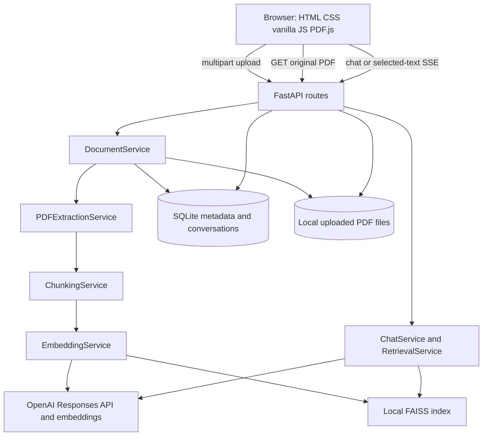
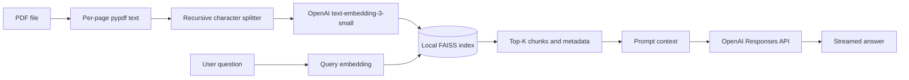
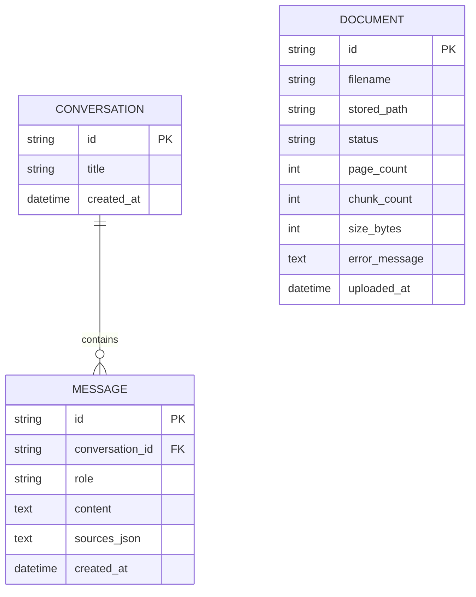

# PDF-ChatGPT

PDF-ChatGPT is a single-process PDF reading and question-answering application. It serves a vanilla JavaScript interface and FastAPI endpoints, stores uploaded PDF files locally, extracts page-aware text, indexes overlapping chunks in a local FAISS index, and uses OpenAI Responses API calls for grounded chat and selected-text explanations.

---

## 1. Overview

The application lets a user upload and read text-based PDFs, select a passage, ask for an explanation, or ask document-level questions. It is designed as a self-hosted, single-tenant tool for individual users or small teams, not as a multi-tenant service.

Its main paths are PDF ingestion and indexing, in-browser PDF reading, selected-text explanation, semantic retrieval, and persisted conversations. PDF text is processed on the backend; the browser separately renders the original file so the reader preserves its visual layout.

---

## 2. Key Features

Implemented:

- PDF upload with extension and configurable byte-size checks; multiple files can be selected in the UI.
- Local persistence of original PDFs and SQLite document metadata.
- Per-page text extraction with `pypdf`, followed by overlapping character-based chunking.
- PDF.js viewer with lazy page rendering, page navigation, zoom, text selection, and text search.
- Selected-text panel with document/page context and an Explain action.
- Selected-passage explanations streamed over Server-Sent Events (SSE), with bounded neighboring-page text and optional same-document FAISS retrieval.
- General semantic document chat, an additional structured-answer API, citations from retrieved chunks, and persisted conversation history.
- Document list, status/error display, opening failed-index PDFs, and deletion.
- Dark/light theme preference stored in browser `localStorage`; responsive reader/chat layout.
- FastAPI Swagger, ReDoc, and OpenAPI endpoints.

Partially implemented or unavailable:

- Scanned/image-only PDF support: **not implemented**; there is no OCR pipeline.
- AI generation and embedding: implemented through OpenAI but requires an API key with usable quota. An API key being present does not establish that billing or quota is available.
- Vector retrieval for selected-text explanations: used only when the document is indexed. Failed-index documents can still be read and explained using selected text and locally extracted neighboring-page context.

---

## 3. System Architecture



The app has no separate frontend server or build step. FastAPI serves `app/static/index.html` at `/` and mounts the static assets at `/static`. API routes validate and translate HTTP requests; services orchestrate extraction, indexing, retrieval, and generation. SQLite is the system of record for document metadata and conversations. PDF bytes and FAISS artifacts are stored on the local filesystem.

There is no authentication, user/tenant boundary, queue, remote vector service, or database migration framework. The current architecture assumes one application process or a deployment with carefully coordinated shared local storage.

---

## 4. End-to-End Data Flow

```text
Upload:
Browser -> POST /api/documents -> validate -> write original PDF -> SQLite document row
        -> pypdf page extraction -> page-aware chunks -> OpenAI embeddings -> FAISS files

Read and explain:
Browser -> GET /api/documents/{id}/file -> PDF.js canvas + selectable text layer
        -> selection + page + question -> POST /api/chat/explain/stream
        -> neighboring-page extraction + optional same-document FAISS retrieval
        -> OpenAI Responses API -> SSE tokens -> browser chat

General chat:
Browser -> POST /api/chat/stream -> query embedding/retrieval -> prompt + history
        -> OpenAI Responses API -> SSE tokens and citations -> browser chat
```

### PDF Upload Flow

The browser posts a multipart `file` to `POST /api/documents`. The route reads the complete request body into memory and delegates to `DocumentService`. The service checks the `.pdf` extension and configured size limit, writes the raw bytes under a UUID-prefixed filename in `UPLOAD_DIR`, and creates a SQLite record before extraction/indexing. The UI refreshes the library and opens the new document even when indexing has failed, provided the backend created a document record.

### PDF Processing Flow

`PDFExtractionService.extract_pages` returns one text string per PDF page. The chunker processes each page independently, so every `TextChunk` retains a 1-based page number. The original file is not converted into HTML or replaced by extracted text in the reader; PDF.js displays the original PDF.

### Text Selection Flow

PDF.js renders each visible page to a canvas and overlays a selectable text layer. The frontend listens for browser selection changes, associates the selection with its page element, caps the captured text at 12,000 characters, and displays it in the selected-text panel. “Explain selection” fills the chat composer; submitting sends `selected_text`, `user_question`, `document_id`, `page_number`, and optional `conversation_id` separately.

### Chat Flow

The regular chat endpoint accepts a question and optional document scope. The selected-text endpoint has a separate request schema and prompt path. Both stream responses using SSE and use the existing SQLite-backed conversation service for follow-up history. The UI maintains active IDs and reader state in a JavaScript closure; the theme preference alone is persisted in `localStorage`.

### RAG Flow

At ingest time, extracted chunks are embedded and added to FAISS. At chat time, the query is embedded by LangChain’s FAISS integration, matching chunks are returned with page/document metadata, and the chat service formats them into prompt context. Selected-text explanations also retrieve up to three chunks from the selected document, but only if its status is `indexed`.

### LLM Request Flow

The chat service calls `client.responses.stream(...)` for streaming chat and explanations. The structured endpoint calls `client.responses.parse(...)` with the `StructuredAnswer` Pydantic schema. Conversation history is read before generation and capped at 12 messages by `MemoryService`.

---

## 5. RAG Architecture



- **Ingestion:** `DocumentService.ingest` extracts pages, chunks them, calls `VectorStoreService.add_chunks`, and updates document status and counts.
- **Chunking:** `RecursiveCharacterTextSplitter` uses separators `\n\n`, `\n`, `. `, space, then an empty separator. `length_function=len` means sizes are characters, not tokens. Defaults are 1,000 characters and 150-character overlap; both are configurable.
- **Page and chunk metadata:** each FAISS document stores `chunk_id`, `document_id`, `document_name`, `page_number`, and `chunk_index` alongside its page content.
- **Embeddings:** `OpenAIEmbeddings` uses `text-embedding-3-small` by default. No explicit dimensions override is configured; the provider model default applies.
- **Vector storage:** LangChain’s FAISS wrapper persists local `index.faiss` and `index.pkl` artifacts under `VECTOR_STORE_DIR`. SQLite does not store chunk text or vectors.
- **Search:** `RETRIEVAL_TOP_K` defaults to 4. When filtering by `document_ids`, the vector service over-fetches `top_k * 5`, then filters metadata and stops at `top_k`. Retrieval applies a 0.15 relevance threshold, but falls back to the unfiltered results if every score is below that threshold.
- **Metric:** the code does not configure a custom FAISS distance strategy or normalization; LangChain FAISS defaults apply (Euclidean/L2 by default).
- **Prompt context:** retrieved passages include document name, page, relevance score, and content. General chat asks the model to use the provided excerpts. Selected-text chat places the selection first, then bounded nearby text, retrieved excerpts, and the user question.

No separate vector database server, collection schema, or vector migration mechanism exists. FAISS document identity is carried in metadata; there is no relational `Document`-to-chunk table.

---

## 6. PDF Processing Architecture

1. `POST /api/documents` reads a multipart PDF and `DocumentService.save_upload` writes it to `UPLOAD_DIR` using a UUID and sanitized basename.
2. Upload validation checks the filename extension and `MAX_UPLOAD_MB`. The backend then uses `pypdf.PdfReader` to extract each page independently.
3. Encrypted PDFs are attempted with an empty password. Pages with extraction exceptions become empty text; if all pages are empty, ingestion fails. OCR is not performed.
4. `ChunkingService` skips blank pages and produces chunks with sequential indices and original page numbers.
5. PDF.js fetches the saved original from `GET /api/documents/{document_id}/file` and renders it in the browser. Search extracts page text through PDF.js; selection comes from its text layer.
6. For selected-text explanation, `DocumentService` reopens the PDF and extracts text around the selected passage. It includes up to 600 characters before and after the match and up to 400 characters from adjacent pages. If the selection cannot be matched in extracted text, it uses bounded beginning/end slices of the selected page.

The backend repeats extraction from the PDF for each selected-text request; it does not persist full extracted page text in SQLite. The request does not send the full PDF to the LLM.

---

## 7. AI / LLM Architecture

OpenAI is the provider for both embeddings and generation. The chat model defaults to `gpt-4.1-mini`; the embedding model defaults to `text-embedding-3-small`. Both are configurable. The secret is read server-side using `OPENAI_API_KEY` or the accepted alias `LLM_API_KEY`; it is not placed in frontend code.

`ChatService` owns prompt construction and OpenAI SDK calls. `app/core/constants.py` defines separate system prompts for general grounded chat, structured answers, and selected-text explanation. The selected-text prompt structure is:

```text
Selected text (primary source, {document}, page {page}):
{selected_text}

Nearby PDF context (use only if relevant):
{bounded_context}

Retrieved PDF excerpts (use only if relevant):
{top_k_context_or_None}

User's question (answer this request about the selected text):
{user_question}
```

The explanation system prompt tells the model to prioritize the selection, preserve its meaning, avoid unsupported claims, explain terminology, respond in the requested language, and use conversation history for follow-ups. These are prompt instructions, not an independent factuality guarantee or prompt-injection defense.

The Responses API stream is translated into SSE `token` events. Conversation input consists of stored prior turns plus the current user prompt. The model call is made on the backend; no key is returned by the health endpoint, which reports only whether a key is configured.

---

## 8. API Documentation

Interactive documentation is generated at `/api/docs` (Swagger UI), `/api/redoc`, and `/api/openapi.json`.

| Method | Endpoint | Purpose |
|---|---|---|
| `GET` | `/api/health` | Liveness/configuration indicator; key presence is not validated against OpenAI. |
| `POST` | `/api/documents` | Upload, extract, chunk, embed, and index a PDF. Multipart field: `file`. |
| `GET` | `/api/documents` | List document metadata and indexing status. |
| `GET` | `/api/documents/{document_id}` | Get one document’s metadata. |
| `GET` | `/api/documents/{document_id}/file` | Stream the original stored PDF for PDF.js. |
| `DELETE` | `/api/documents/{document_id}` | Delete the PDF, indexed document entries, and SQLite metadata. |
| `POST` | `/api/chat` | Return a structured, non-streaming RAG answer. |
| `POST` | `/api/chat/stream` | Stream a general RAG answer as SSE. |
| `POST` | `/api/chat/explain/stream` | Stream an answer focused on selected PDF text. |
| `GET` | `/api/conversations` | List conversation summaries. |
| `GET` | `/api/conversations/{conversation_id}` | Return a conversation with messages. |

### `POST /api/chat`

Request:

```json
{
  "question": "What does the document say about indexing?",
  "conversation_id": null,
  "document_ids": null,
  "top_k": 4
}
```

`conversation_id`, `document_ids`, and `top_k` are optional. `top_k` is limited to 1–20. The response is a `StructuredAnswer` containing `answer_found`, `answer`, `key_points`, `sources`, and `confidence`.

### `POST /api/chat/stream`

Uses the same `ChatRequest` shape. The response is `text/event-stream` with `meta`, `token`, `sources`, `done`, and potentially `error` events. The frontend uses this endpoint for general chat.

### `POST /api/chat/explain/stream`

Request:

```json
{
  "selected_text": "Gradient descent updates model weights.",
  "user_question": "Explain this simply.",
  "document_id": "document-uuid",
  "page_number": 7,
  "conversation_id": null
}
```

`selected_text` is limited to 12,000 characters; `user_question` to 4,000. Both must contain non-whitespace text; page numbers must be at least 1. The SSE response uses the same `meta`, `token`, `sources`, `done`, and `error` event types.

### Document upload response

On successful indexing, `POST /api/documents` returns HTTP 201 with a `document` object (`id`, `filename`, `status`, `page_count`, `chunk_count`, `size_bytes`, `uploaded_at`, and optional `error_message`). Invalid type, unreadable/empty text, and oversized files are rejected. OpenAI embedding failures return HTTP 502 with a message explaining that the PDF was saved but indexing failed. Other indexing failures return HTTP 500.

### Important error cases

- `400`: unsupported extension, file too large, or no extractable text.
- `404`: unknown document/conversation or missing stored PDF file.
- `409`: vector store is not ready for the general chat endpoints.
- `412`: missing OpenAI key on the structured chat path.
- `422`: invalid request body, including blank selected text/question.
- `502`: provider failure during PDF embedding or structured generation.
- SSE `error`: generation failed after a streaming response has begun.

`GET /api/health` only checks whether a key string exists. It does not test API access, billing, quota, or model permissions.

---

## 9. Database Architecture

The default database is SQLite at `data/app.db`, managed by SQLAlchemy. `init_db()` calls `Base.metadata.create_all()` during application startup. No Alembic or other schema migration system is present.

Tables:

- `documents`: UUID-like ID, filename, stored filesystem path, status, page/chunk counts, byte size, error message, upload timestamp. It does not contain page text, chunks, or vectors.
- `conversations`: ID, title, creation timestamp.
- `messages`: ID, foreign key to conversation, role, text content, serialized source references, creation timestamp.



`DOCUMENT` has no relational foreign-key relationship to conversations or messages. Source references and selected passage details are serialized into message content/source JSON, while chunk identity is in FAISS metadata.

---

## 10. Vector Database

The vector store is FAISS through `langchain-community`, persisted locally under `VECTOR_STORE_DIR`. It uses LangChain’s default FAISS configuration; this code does not set custom dimension, distance, normalization, namespace, or collection options. With the default `text-embedding-3-small` model, provider-default dimensions are used.

Each vector entry’s document metadata includes `chunk_id`, `document_id`, `document_name`, `page_number`, and `chunk_index`. Retrieval scopes by `document_id` after over-fetching because FAISS does not perform the project’s metadata filter natively. This lets retrieved passages be traced to a document and page without a separate chunks table.

The index is loaded lazily and shared through process-wide service singletons. Deletion filters the in-memory FAISS docstore and rebuilds the index from remaining documents; rebuilding calls the embedding integration again and may require a working provider/quota. FAISS persistence uses a pickle metadata file loaded with `allow_dangerous_deserialization=True`; protect the index directory from untrusted writes.

---

## 11. Frontend Architecture

The frontend is a single HTML document with CSS and a vanilla JavaScript IIFE. There is no React/Vue framework, client-side router, component build system, or separate API client module. `app.js` owns DOM references, UI state, `fetch` calls, SSE parsing, document/conversation lists, reader controls, selection handling, and theme preference.

```text
index.html
├── Sidebar
│   ├── Upload control and document library
│   ├── Conversation list
│   └── Health indicator / API docs link
└── Reader-chat workspace
    ├── PDF reader
    │   ├── Page / zoom / search toolbar
    │   ├── PDF.js canvas pages
    │   └── Selectable text layer
    └── Chat panel
        ├── Selected-text context panel / Explain action
        ├── Message history
        └── Message composer
```

State such as the active document, selected passage, current page, reader zoom, conversation ID, and current messages lives in memory. Only the theme is persisted in `localStorage`; conversations are fetched from the backend. PDF.js 3.11.174, Marked 12.0.2, and Highlight.js 11.9.0 are loaded from cdnjs, so a network connection to that CDN is required. The reader lazily renders pages near the scroll viewport using `IntersectionObserver`.

---

## 12. Backend Architecture

```text
app/
├── main.py                    FastAPI construction, lifespan, CORS, errors, static serving
├── config.py                  Pydantic Settings and environment aliases
├── logging_config.py          Console + rotating file logging
├── api/
│   ├── deps.py                Process-wide services and database dependencies
│   ├── routes_health.py       Health endpoint
│   ├── routes_documents.py    Upload, file, metadata, list, delete endpoints
│   └── routes_chat.py         RAG, selected-text, and conversation endpoints
├── core/
│   ├── constants.py           System prompts and FAISS filenames
│   └── exceptions.py          Application exception classes
├── domain/
│   ├── models.py              Dataclass domain entities and statuses
│   └── schemas.py             Pydantic request/response contracts
├── infrastructure/
│   ├── db.py                  SQLAlchemy engine, sessions, create_all initialization
│   ├── models_db.py           SQLite ORM tables
│   └── repository.py          Persistence adapters
└── services/
    ├── document_service.py    Upload orchestration and document lifecycle
    ├── pdf_service.py         Per-page PDF extraction and surrounding context
    ├── chunking_service.py    Page-aware text chunking
    ├── embedding_service.py   OpenAI embedding client
    ├── vector_store_service.py FAISS index operations
    ├── retrieval_service.py   Top-K retrieval and context formatting
    ├── chat_service.py        Prompts and OpenAI Responses API calls
    └── memory_service.py      SQLite-backed conversation memory
```

FastAPI dependency functions in `app/api/deps.py` share chat, embedding, retrieval, and vector-store services per process. Document and memory services are constructed with request-scoped SQLAlchemy sessions.

---

## 13. Repository Structure

```text
pdf-chatgpt/
├── .github/workflows/ci.yml       GitHub Actions lint/test workflow
├── .vscode/                       Debug, test, and editor configuration
├── app/                           Application source (see backend/frontend sections)
├── data/
│   ├── sample_docs/                Sample PDF fixture
│   ├── uploads/                    Runtime PDF storage; ignored by Git
│   ├── vector_store/               Runtime FAISS files; ignored by Git
│   └── app.db                      Runtime SQLite database; ignored by Git
├── logs/                           Rotating runtime logs; ignored by Git
├── tests/                          Pytest unit/API tests and fixtures
├── .env.example                    Non-secret configuration template
├── .gitignore                      Excludes secrets and runtime/user data
├── INSTRUCTION.md                  Longer beginner setup guide
├── LICENSE                         MIT license
├── pyproject.toml                  Ruff, mypy, and pytest configuration
├── requirements.txt                Runtime dependencies
├── requirements-dev.txt            Runtime + test/lint/type-check dependencies
├── Start App.bat                   Windows setup/launch helper
├── Start App (Mac).command         macOS setup/launch helper
└── README.md
```

The frontend files are `app/static/index.html`, `app/static/css/style.css`, and `app/static/js/app.js`. Runtime `data/`, `.env`, logs, and FAISS files should not be committed.

---

## 14. Environment Variables

The settings class reads `.env` from the process working directory. The committed `.env.example` contains placeholders only. `.env` is ignored by Git.

| Variable | Default | Purpose |
|---|---|---|
| `APP_NAME` | `PDF-ChatGPT` | Health/API application name. |
| `APP_ENV` | `development` | Environment label returned by health check. |
| `APP_VERSION` | `1.0.0` | Application version. |
| `DEBUG` | `true` | Controls reload when running `python -m app.main`. |
| `HOST` | `0.0.0.0` | Host used by `python -m app.main`; launcher scripts pass their own host. |
| `PORT` | `8000` | Port used by `python -m app.main`; launcher scripts pass their own port. |
| `CORS_ORIGINS` | `*` | Comma-separated origins or wildcard; wildcard is development-oriented. |
| `OPENAI_API_KEY` / `LLM_API_KEY` | empty | OpenAI credential. Set one; both names resolve to the same setting. |
| `OPENAI_CHAT_MODEL` | `gpt-4.1-mini` | Responses API generation model. |
| `OPENAI_EMBEDDING_MODEL` | `text-embedding-3-small` | Embedding model for chunks and queries. |
| `OPENAI_REQUEST_TIMEOUT` | `60` | OpenAI client timeout in seconds. |
| `OPENAI_MAX_OUTPUT_TOKENS` | `1024` | Max generated output tokens. |
| `CHUNK_SIZE` | `1000` | Chunk size in characters. |
| `CHUNK_OVERLAP` | `150` | Overlap in characters. |
| `RETRIEVAL_TOP_K` | `4` | Default retrieval count. |
| `MAX_UPLOAD_MB` | `25` | Maximum accepted upload size after request body read. |
| `DATA_DIR` | `./data` | Base data directory setting. |
| `UPLOAD_DIR` | `./data/uploads` | Original PDF storage. |
| `VECTOR_STORE_DIR` | `./data/vector_store` | Local FAISS index directory. |
| `DATABASE_URL` | `sqlite:///./data/app.db` | SQLAlchemy database connection string; SQLite is the included/default deployment. |
| `LOG_DIR` | `./logs` | Rotating log directory. |
| `LOG_LEVEL` | `INFO` | Python logging level. |

There is no `VECTOR_DB_URL` setting: vector storage is local FAISS controlled by `VECTOR_STORE_DIR`. The application does not configure a remote vector database.

---

## 15. Installation

### Prerequisites

- Python 3.12 or newer.
- OpenAI API account/key with access and quota for the configured embedding and chat models if using AI features.
- Network access to the configured OpenAI endpoints and cdnjs-hosted browser libraries.

There is no Node.js package manifest or frontend installation step.

### Setup

From the repository root:

```powershell
python -m venv venv
venv\Scripts\Activate.ps1
python -m pip install --upgrade pip
pip install -r requirements-dev.txt
Copy-Item .env.example .env
```

On macOS/Linux, activate with `source venv/bin/activate` and copy the template with `cp .env.example .env`.

Set `OPENAI_API_KEY` (or `LLM_API_KEY`) in `.env`; do not commit the secret. `DATABASE_URL` defaults to SQLite. The database tables and runtime directories are initialized/created by application startup and settings validation; no separate migration command exists. FAISS is created when the first document is successfully indexed.

### Run

From the repository root with the virtual environment active:

```bash
uvicorn app.main:app --reload
```

Open `http://localhost:8000`. The Windows and macOS launcher scripts create/activate `venv`, install runtime requirements if FastAPI is absent, copy `.env.example` when needed, create runtime folders, and run Uvicorn with reload enabled. There is no frontend build command.

---

## 16. Development Workflow

- **UI, reader, selection, or browser API behavior:** `app/static/index.html`, `app/static/css/style.css`, and `app/static/js/app.js`.
- **Add/change an HTTP endpoint:** add the route in `app/api/routes_chat.py`, `routes_documents.py`, or `routes_health.py`; put orchestration in a service and request/response validation in `app/domain/schemas.py`.
- **PDF parsing/context:** `app/services/pdf_service.py`.
- **Chunk boundaries/metadata:** `app/services/chunking_service.py` and `app/domain/models.py`.
- **Embedding provider/model construction:** `app/services/embedding_service.py` and `app/config.py`.
- **FAISS persistence/search/deletion:** `app/services/vector_store_service.py`.
- **Retrieval threshold, top-K formatting:** `app/services/retrieval_service.py`.
- **Prompt, model calls, citations:** `app/core/constants.py` and `app/services/chat_service.py`.
- **Conversation memory:** `app/services/memory_service.py` and `app/infrastructure/repository.py`.
- **Schema changes:** `app/infrastructure/models_db.py`; there is no migration framework, so `create_all` does not migrate existing columns.
- **Add/adjust coverage:** existing files under `tests/`; test fixtures configure isolated temporary storage.

Run `ruff check app tests` and `pytest tests -v`. GitHub Actions currently runs those two checks on pushes and pull requests to `main`.

---

## 17. Error Handling

- **Invalid extension / oversized file / empty extracted text:** application exceptions become HTTP 400. Validation checks the suffix and size; file bytes are read before the size check.
- **Malformed PDF:** `PdfReadError` is translated to an unsupported-PDF error. Other parser exceptions may reach the general error handler. Page-level extraction exceptions are logged and converted to empty page text.
- **Encrypted PDF:** the parser attempts an empty password; protected PDFs that cannot be decrypted are rejected.
- **Scanned PDF:** no OCR is attempted; all-empty extraction returns a useful no-extractable-text message.
- **Embedding provider failure during upload:** the original file and document record are retained; extracted page/chunk counts are stored before embedding. OpenAI errors return HTTP 502. Unexpected indexing errors return HTTP 500 with a saved-file message.
- **Missing document/file:** document and file routes return HTTP 404.
- **Empty selected text/question or page number below 1:** Pydantic returns HTTP 422. A page number beyond the PDF's page count is not rejected at request validation; surrounding context is empty.
- **Missing vector index:** general chat maps `VectorStoreNotReadyError` to HTTP 409. Selected-text explanation skips FAISS retrieval for failed-index documents and can use local PDF context instead.
- **LLM failures:** structured chat maps provider failures to HTTP 502; streaming chat/explanation report errors as SSE events. A failure after the user message has been stored can leave that user turn without an assistant response.
- **Unexpected errors:** `app/main.py` returns a generic 500 body and logs the traceback. Upload routes have additional indexing-specific messages.
- **Network failure in browser:** health checks mark the API unavailable; upload/chat requests show a toast or inline error. CDN failures prevent PDF.js/Markdown/highlighting scripts from loading.

---

## 18. Security

- **API keys:** read by backend settings and not embedded in frontend source. `.env` is ignored by Git. Rotate any key accidentally shared or committed. Health reports key presence only.
- **Authentication/authorization:** **not currently implemented**. All API routes, uploaded documents, conversations, and file downloads are accessible to any client that can reach the server. Add identity, ownership checks, and per-resource authorization before exposing this beyond a trusted local network.
- **Upload validation:** extension and byte-size limits exist, but MIME type and PDF magic bytes are not independently validated before storage. The request body is buffered in memory before size validation. Add streaming limits, content inspection, malware scanning, and safe storage isolation for hostile users.
- **CORS:** configurable, but defaults to `*` while credentials are enabled. Restrict origins in any shared deployment.
- **Rate limiting / abuse controls:** **not currently implemented**. Add limits for uploads, chat, token use, and concurrent requests.
- **Prompt injection:** selected text, PDF text, and retrieved chunks are untrusted input. System prompts request grounded answers but do not implement a robust injection boundary or output verification.
- **HTML rendering:** model Markdown is converted with Marked and assigned to `innerHTML`; no HTML sanitizer or Content Security Policy is configured. Sanitize rendered Markdown and apply a restrictive CSP before exposing the app to untrusted users.
- **FAISS metadata:** loading uses `allow_dangerous_deserialization=True` for the local pickle index. Treat vector-store files as trusted application data and restrict filesystem writes.
- **Sensitive content:** uploaded PDFs are stored locally and extracted/selected text is sent to OpenAI for embeddings or generation. Conversation messages can persist selected text. Document retention, deletion policy, and provider data controls should be reviewed for the deployment’s requirements.
- **TLS / secrets management:** **not configured by the repository**. Terminate TLS and inject secrets through a protected deployment secret store.

---

## 19. Performance Considerations

- Uploads are limited by `MAX_UPLOAD_MB` (25 MB by default), but the route reads the full body into memory and performs synchronous PDF parsing/chunking/embedding from an async endpoint. Large or concurrent uploads can block the event loop and consume memory.
- Embeddings require external API calls. Chunking and embedding work is synchronous; there is no background job queue, retry policy, batching control exposed to users, or resumable ingestion.
- FAISS search is local and avoids a network hop. Per-document retrieval over-fetches up to five times the requested top-K because filtering is applied in application code.
- Selected-text context extraction reopens and extracts every PDF page for each explanation request, then sends only a bounded window plus at most three retrieved chunks.
- Chat prompt history is limited to the latest 12 messages. The selected passage can be up to 12,000 characters; the API does not estimate the final combined prompt token budget.
- PDF.js lazily renders pages near the viewport and uses device pixel ratio for canvas resolution. Search still extracts page text sequentially until a match is found; rendering all pages is not eager.
- SQLite, FAISS files, and the in-process lock are suitable for a small single-process deployment, not uncoordinated multi-worker writes.

### Potential Improvements

- Move extraction, embedding, and index mutation to a background worker with progress/status polling and idempotent retries.
- Stream uploads to disk and enforce request-size limits before buffering.
- Persist extracted page text to avoid reopening and re-extracting the PDF for every selection.
- Use a shared database/vector service and distributed locking for multi-instance deployments.
- Add prompt token budgeting, request cancellation, caching, rate limits, and observability for provider cost/latency.

---

## 20. Testing

Tests cover health and docs routes, upload validation/list/file serving, chunking, PDF extraction behavior, selected-text context/prompt construction, and the selected-text SSE contract. The API upload test that performs real embeddings is skipped when the test key starts with `sk-test`.

```bash
pytest tests -v
ruff check app tests
mypy app
```

The repository’s current full test run has a known failure: `test_extract_pages_returns_text_per_page` cannot parse the bundled `data/sample_docs/sample-rag-guide.pdf` with the installed `pypdf` version. The CI workflow runs the same full suite, so this fixture issue should be fixed before treating CI as green. The real-provider ingestion test is intentionally skipped under CI’s test key.

Coverage is missing or limited for real OpenAI generation/error modes, real vector similarity behavior, multi-page PDF.js selection/search in automated browser tests, upload concurrency, and the full deployment/security boundary. Keep provider calls mocked in normal CI; use a separately gated integration suite for billable API tests.

---

## 21. Known Limitations

- The checked-in sample PDF currently fails the PDF extraction test; this makes the full test suite/CI fail in the inspected environment.
- OpenAI quota, billing, credentials, model permissions, and provider availability are external prerequisites. Health only checks that a key is non-empty.
- No OCR, authentication, authorization, user separation, rate limiting, or request-level upload streaming.
- No schema migrations; `create_all()` creates missing tables but does not evolve existing tables.
- SQLite and FAISS are local, process-oriented stores; horizontal scaling and concurrent multi-process index updates are not addressed.
- FAISS document deletion reconstructs embeddings for the remaining entries, which can incur provider cost and fail if quota is unavailable.
- Selected-text retrieval is conditional on document status `indexed`; failed-index PDFs use only selected text and local neighboring text for explanation.
- Conversation rows are not linked to a document. A conversation can contain selected text/page details in stored message content, but there is no document-session foreign key.
- No persistent state for the active PDF/selection in the browser; reload returns to the empty reader until the user opens a library item.
- PDF.js, Marked, and Highlight.js come from a CDN; no local asset bundling, integrity attributes, or offline fallback.
- The search UI finds page-level text matches; matching/highlighting across multiple separate PDF text spans is limited.
- Error paths in streaming endpoints can persist a user message before generation succeeds.
- There is no actual Docker/cloud deployment configuration, managed database setup, or remote vector service configuration.

---

## 22. Future Improvements

### Security and tenancy

- Add authentication, document ownership, authorization, request limits, secure secret injection, CSP, sanitized Markdown, and restrictive production CORS.
- Define retention/deletion behavior for PDF files, selected text, extracted text, and conversation history.

### Ingestion and RAG

- Fix/replace the sample fixture and add tests for parser edge cases, OCR, embedding errors, and FAISS restart/retrieval behavior.
- Add OCR, configurable token-aware chunking, hybrid retrieval, reranking, ingestion retries, and better page-context alignment.
- Move vector storage to a managed/shared system only if deployment scale requires it; add schema/versioning for stored metadata.

### UX and operations

- Add document-level conversation ownership, active-reader restoration, accessible keyboard shortcuts, selection handling across spans, and automated browser tests.
- Add background ingestion progress, API metrics, tracing, structured provider error categories, cost tracking, and health/readiness checks that distinguish configuration from provider availability.
- Add migrations and a documented production deployment with persistent object storage/database/vector infrastructure.

---

## 23. Deployment Architecture

**Deployment configuration is not currently present.** The repository includes local Uvicorn launchers and a GitHub Actions lint/test workflow, but no Dockerfile, compose stack, cloud manifest, reverse-proxy config, or managed persistence setup.

The current runtime topology is:

```text
Browser
  -> FastAPI (static UI + API, one process)
       -> local uploaded PDF directory
       -> SQLite metadata/conversations
       -> local FAISS files
       -> OpenAI embeddings and Responses API
```

For any non-local deployment, provide persistent storage for PDFs, SQLite, and FAISS; inject API credentials securely; terminate TLS; restrict CORS; and ensure only one coordinated writer mutates the local FAISS index. The application does not currently configure or validate such a deployment.

---

## 24. Troubleshooting

### PDF upload returns an error but the file is visible

The raw PDF is saved before indexing. Check the document’s status/error in the library and `logs/app.log`. If the error mentions insufficient quota or a provider rejection, restore API access/quota and upload again; a failed document is not automatically re-embedded.

### PDF does not open in the reader

Check that the document still exists in the library and that `GET /api/documents/{id}/file` succeeds. PDF.js is loaded from cdnjs, so check browser network access to that host. Invalid/encrypted PDFs may not render.

### “No extractable text”

The PDF may contain scanned images or have no text layer. OCR is not implemented; use a text-based PDF or add an OCR pipeline.

### AI response reports quota, authentication, or model errors

Confirm `OPENAI_API_KEY` or `LLM_API_KEY` is set in `.env`, restart the app, and check provider billing, quota, and model permissions. The green health indicator does not validate these.

### Chat returns 409 / vector store not ready

No FAISS index exists yet. Index a readable PDF with a working embedding provider before using general RAG chat.

### Port 8000 is unavailable

Stop the process using the port or launch Uvicorn with another port, for example `uvicorn app.main:app --reload --port 8001`, then open the matching URL.

### SQLite missing-table error

Tables are initialized during FastAPI lifespan startup. Start the app normally rather than importing route/service code as a standalone script.

### Test suite fails in PDF extraction

The checked-in sample `data/sample_docs/sample-rag-guide.pdf` currently triggers a `pypdf` cross-reference parse error. Replace/rebuild that fixture with a valid PDF before expecting the complete CI test command to pass.

---

## 25. Architecture Decisions

### FastAPI serves both UI and API

- **Decision:** Serve static HTML/CSS/JS and JSON/SSE endpoints from one app.
- **Why:** The repository has no frontend build pipeline or separate frontend server; a reason beyond that is not explicitly documented.
- **Advantages:** One local process/origin and no CORS requirement for the built-in UI.
- **Trade-offs:** Frontend/backend deploy and scale together; static assets are CDN-dependent.

### SQLite for metadata and chat

- **Decision:** SQLAlchemy with SQLite by default.
- **Why:** `db.py` describes it as lightweight and zero-configuration.
- **Advantages:** No separate database service for local use.
- **Trade-offs:** Migrations and production multi-writer behavior are not implemented.

### Local FAISS for vector search

- **Decision:** Persist LangChain FAISS index files under `VECTOR_STORE_DIR`.
- **Why:** Service documentation states local persistence supports self-hosted/small-team use without a separate vector server.
- **Advantages:** Local, simple retrieval with metadata carried alongside chunks.
- **Trade-offs:** Local filesystem lifecycle, pickle trust, process coordination, and rebuild cost become operational concerns.

### `pypdf` plus recursive character splitting

- **Decision:** Extract pages with `pypdf`; split each page independently with LangChain’s recursive character splitter.
- **Why:** Service comments describe page separation and paragraph/sentence/word fallback; broader rationale is not explicitly documented.
- **Advantages:** Simple page citations and usable chunks for ordinary text PDFs.
- **Trade-offs:** No OCR, character counts do not equal tokens, and layout/table structure is not preserved in extracted text.

### OpenAI Responses API

- **Decision:** Use Responses API streaming and structured parsing.
- **Why:** Service comments identify streaming as the UI path and structured parsing as schema-constrained output; the repository describes Responses API as its current generation interface.
- **Advantages:** One SDK surface for streamed and structured answers.
- **Trade-offs:** Runtime depends on a paid/available external provider and prompts are not independently verified.

### PDF.js in the browser

- **Decision:** Render the original file with PDF.js canvas plus text layer.
- **Why:** The reader requires visual PDF fidelity and selectable text; a deeper selection is not documented.
- **Advantages:** Selection and page navigation without converting the PDF to plain text.
- **Trade-offs:** CDN availability/versioning and browser rendering cost are part of the client runtime.

---

## 26. Senior Engineer Quick Start

1. Read this README and `pyproject.toml`.
2. Create a Python 3.12 virtual environment, install `requirements-dev.txt`, and set an OpenAI key in `.env`.
3. Run `uvicorn app.main:app --reload` and open `http://localhost:8000`.
4. Upload a text-based PDF. The original opens in the reader; inspect the library status and `logs/app.log` if indexing fails.
5. Select text, choose Explain, and inspect the `POST /api/chat/explain/stream` SSE path.
6. Trace ingestion through `DocumentService`, `PDFExtractionService`, `ChunkingService`, `EmbeddingService`, and `VectorStoreService`.
7. Trace answer construction through `routes_chat.py`, `RetrievalService`, `ChatService`, `MemoryService`, and the OpenAI Responses API.
8. Run `ruff check app tests` and the focused offline pytest suite. Investigate the known malformed sample-PDF test before expecting full CI to pass.

### Most Important Files

- `app/main.py` — app factory, middleware, exception handlers, static serving, lifespan.
- `app/config.py` — environment variables, defaults, and `LLM_API_KEY` alias.
- `app/api/routes_documents.py` — upload, stored-file serving, document CRUD.
- `app/api/routes_chat.py` — standard chat, selected-text explanation, SSE, conversations.
- `app/api/deps.py` — process-wide service wiring and request-scoped database injection.
- `app/services/document_service.py` — upload lifecycle and ingestion orchestration.
- `app/services/pdf_service.py` — page extraction and neighboring text for selections.
- `app/services/chunking_service.py` — per-page chunk boundaries and metadata.
- `app/services/embedding_service.py` — OpenAI embedding client.
- `app/services/vector_store_service.py` — FAISS persistence, filtering, deletion.
- `app/services/retrieval_service.py` — top-K, threshold, context formatting.
- `app/services/chat_service.py` — prompt construction and Responses API generation.
- `app/services/memory_service.py` — bounded conversation history.
- `app/infrastructure/models_db.py` and `repository.py` — SQLite schema and persistence adapters.
- `app/static/index.html`, `app/static/js/app.js`, `app/static/css/style.css` — existing reader/chat UI.

---

## License

This project is released under the [MIT License](LICENSE).
